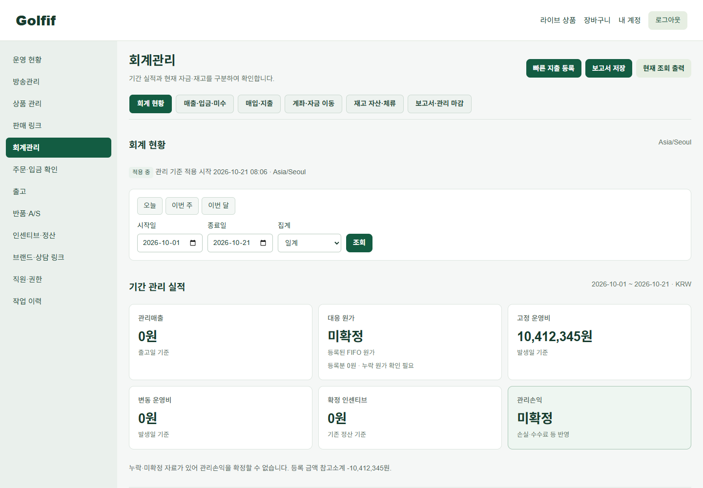

# 0.8.0 판매자 공통 메뉴·회계 화면

> 최신 캡처 피드백 보완: [방송 작업 버튼·지출 요약/업무 메뉴·모바일 KPI/장부](ADMIN_UI_080_POLISH.md). 아래는 그 이전 단계의 기록입니다.


> 최종 보완: [회계 현황 4개 KPI·기간 장부·최신 캡처 및 검증](ADMIN_UI_080_FINAL.md). 아래의 화면 순서/6개 실적 카드는 보완 전 기록입니다.

2026-10-21. 기준 HEAD `d222ad35d0ef23e6f010dc0c34fb79a9207e390b`, main. 시작 작업 트리 깨끗함. 변경은 이 플러그인 내부만이며 commit·push·운영 접속·배포를 수행하지 않았다.

## 확인한 원인

| 문제 | 실제 원인과 수정 |
|---|---|
| 방송 탭이 밑줄 링크 | `broadcasts.css`의 `.broadcast-tabs`는 배치만 정의하고 링크 배경·경계·방문·밑줄 상태 디자인이 없었다. 자산 누락이 아니다. 실제 이전 렌더링은 높이 25.59px·투명 배경·밑줄이었다. 공통 운영 CSS에서 38px·녹색 활성·중립 비활성·방문/hover/focus를 명시했다. |
| 회계에서 왼쪽 메뉴 교체 | 회계 Blade의 별도 메뉴와 상품 Controller의 별도 필터/이름 변경이 원인이었다. 기존 Office 주 메뉴를 단일 원본으로 사용하는 `LiveSellerNavigation`과 공통 Blade로 통일했다. |
| 작은 입력·붙은 조회 버튼 | 회계가 상품 필터 클래스에 의존하면서 자기 화면에 맞는 입력·간격 규칙이 없었다. 운영 영역에만 38px 입력/버튼, 8~12px 간격, 정렬된 라벨과 반응형 열을 적용했다. |
| 큰 안내·초기 설정·여러 입력 폼 | 원래 모두 펼친 문서 구조였다. 설정은 짧은 상태+대화상자로, 입력은 권한별 작업 버튼+대화상자로, 설명과 세부 표는 펼침 영역으로 바꿨다. |
| 내부 기준 문자열 노출 | 원래 Blade가 기준 버전/원천 키를 본문에 직접 출력했다. 업무 명칭을 우선하고 원본은 보고서 정보·입고 근거 등 상세에 보존했다. |
| PDF에 탭 노출 | 새 화면 탭 선택자가 기존 인쇄 숨김보다 구체적이었다. PDF 렌더링으로 발견해 인쇄 선택자를 명시적으로 보완했다. `!important`를 추가하지 않았다. |

공식 자산 경로는 `resources/js/index.js`의 CSS import → `php artisan plugin:build` → `dist/css/plugin.css`, `dist/js/plugin.iife.js` → 공식 `plugin:update` 활성 복사 → `LiveAssetController` 제공이다. 원래 자산도 정상 로드됐음을 브라우저에서 확인했다. `admin.css`를 기존 CSS 뒤에 불러와 판매자 `.live-operator` 범위에서 적용한다. 공개 Golfif 메인·고객·개인 스토어 디자인을 변경하지 않았다.

## 구현 범위와 유지한 의미

- 같은 역할은 방송·상품·주문·출고·회계에서 같은 항목·순서·명칭·240px 메뉴를 사용한다. 회계 하위/저장 보고서는 회계관리만 활성화한다. 모바일은 같은 메뉴를 접는다. 인센티브·정산은 기존 주 메뉴에만 남겼다.
- 방송 3개, 회계 6개 탭을 제목 아래에 배치했다. 방문 후에도 기본 보라색/밑줄이 나타나지 않으며 키보드 포커스·현재 위치를 제공한다. 좁은 화면의 탭만 가로 스크롤된다.
- 업체 시간대로 오늘/이번 주(월요일부터 오늘)/이번 달 빠른 선택을 제공하고, 기존 시작일·종료일·일계/주계/월계 규칙은 유지했다. 탭 이동 시 기간을 보존한다.
- 기존 보고서 결과의 `revenue`, `cogs`, `fixed`, `variable`, `incentive`, `management_subtotal`을 그대로 표시한다. 존재하지 않는 운영비 합계를 새로 계산하지 않았다. 현금 유입/유출·현재 미수·고객 예수금은 별도 그룹으로 구분한다.
- 원가 누락/기초층 대기 등의 플래그가 있으면 대응 원가를 **미확정**으로 표시하고 등록분은 작은 참고값으로만 표시한다. 기존 결과에서 손익이 null이면 **미확정**이다. 입금을 매출로 대체하지 않는다.
- 모든 기간별 표·재고 대사·현재 상태 분석·자금 상세는 펼침 영역에 유지했다. 인쇄 시 필요한 표는 자동으로 펼치고 인쇄 후 원래 상태로 되돌린다. 서버 페이지네이션·조회 조건 전체 합계를 유지한다.
- 초기 설정의 기초층 의미·소급하지 않음·미등록 원가·사유·명확한 확인을 보존했다. **미설정 화면 조회 시 보고서를 생성하지 않는다.** 기존 보고서 조회 Service가 `ledger.viewed` 감사 기록을 쓰기 때문에, 초기 설정 전에는 집계를 호출하지 않고 미설정 상태를 표시한다. 설정된 업체의 기존 감사 기록 정책은 유지한다. GET/대화상자 열기만으로 적용하거나 DB를 바꾸지 않는다.
- 고정 환율/원통화 숫자는 원래 소수 자릿수를 보존하는 문자열 자릿수 구분만 적용했다. 변환·반올림 로직을 바꾸지 않았다.
- 금융 Service·원장·FIFO·관리매출·원가·환율·반올림·주문 스냅샷·불변 보고서·인센티브 계산은 변경하지 않았다. 시작/마감/재개와 서버 권한·업체 격리도 유지했다. 신규 migration과 데이터 변환은 없다. 정식 회계 마감·세무 장부로 표현하지 않는다.

주요 파일: `src/Support/LiveSellerNavigation.php`, `LiveDisplay.php`, seller Controller 4개, `resources/views/layouts/operations.blade.php`, `seller/navigation.blade.php`, `finance*.blade.php`, 방송/office Blade, `resources/css/admin.css`, `live.css`, `finance.css`, `resources/js/index.js`, `finance.js`. 5종 manifest·lock·공식 dist·테스트·문서도 갱신했다. [전체 변경 범위](CHANGED_FILES.md).

## 격리 검증 결과

실제 G7 애플리케이션과 플러그인 Blade·공식 빌드 자산을 사용했다. 브라우저는 실제 Chrome 155.0.8059.84(headless), 뷰포트는 **1440×1000, 1920×1000, 390×1000**이다. CSS만 주입한 모형 화면이 아니다. 합성 업체/상품/주문/지출/계좌와 별도의 빈 업체를 사용했다.

| 검증 | 결과 |
|---|---|
| 전체 PHP 기능 회귀 | **242 tests / 72,456 assertions 통과**, 7분43초, 144MiB |
| 최종 UI 집중 회귀 | **6 tests / 2,097 assertions 통과**, 공통 메뉴·권한·초기 설정 읽기 불변·명시적 시작·표시 숫자 보존 |
| JS/실제 G7 레이아웃 테스트 | **5 files / 13 tests 통과**. 기존 autoBinding React 경고는 남아 있으며 실패는 없음. |
| 공식 Composer 설치 스모크 | **2 tests / 29 assertions 통과** |
| 공식 0.7.0→0.8.0 업데이트 | 격리 DB/애플리케이션에서 통과, 이후 최종 `--force` 반영도 통과 |
| 공식 빌드·라우트 캐시·vendor 무결성 | 모두 통과. 파일 SHA/버전은 [release.json](verification/admin080/release.json). |
| 공통 메뉴·탭 | 방송+6개 회계 화면을 3개 폭으로 확인. 항목/순서/명칭 동일, 회계 활성 유지. 탭 높이 38px·짙은 녹색/흰 글자·밑줄 없음. 키보드 focus 3px 확인. |
| 초기 설정 | 빈 업체 설정 전/후 3개 폭 확인. GET+열기+닫기 후 State/Operation/Audit/Expense/FundEntry/Report 수 동일. 확인 POST 이후에만 State 0→1·Operation 0→1. |
| 실업무 | 빠른 기간 조회, **12,345원 지출 등록**, 보고서 저장·동일 내용 재조회/재출력 통과. 전체 지출 **10,412,345원**이 1·2페이지에서 동일. |
| 목록 상태 | 빈 업체 6개 화면, 검색 결과 없는 매출/재고, 저장 중 버튼 잠금, 실제 서버 422 오류·alert, 오류 뒤 재시도 가능 확인. |
| 제한 직원 | sales 역할에서 방송/상품/주문/매출 화면의 동일 메뉴 확인. 허용된 회계 탭만 표시, 회계 현황 직접 접근 403, 원가 카드 미노출. |
| 회귀 화면 | 상품·방송·주문·출고를 3개 폭에서 확인. 기존 등록/옵션/입고/QR/재고/주문/회계 정책은 전체 PHP 회귀로 확인. |
| A4 PDF | 현황 **4쪽**, 불변 저장 보고서 **36쪽**. 모든 페이지 텍스트 존재, 관리자 메뉴·탭·작업 버튼 제외, 기간 표 포함. 첫/마지막 페이지 렌더링도 시각 확인. |

회계 하위 화면별 확인:

| 화면 | 확인한 내용 |
|---|---|
| 회계 현황 | 기간 필터 정렬·실적/현금 구분·미확정 원가/손익·접힌 상세·빠른 지출·보고서 저장 |
| 매출·입금·미수 | 현재 상태 명칭·금액 우측 정렬·입금/환불 작업 패널·검색 없음·권한 제한 |
| 매입·지출 | 기간 전체 합계와 페이지 소계·서버 2페이지·지출 등록·세부 지급/정기 업무 접기 |
| 계좌·자금 이동 | 자금 잔액·요청 상태 글자·환율 상세·입금계좌/원장 접기·업무별 대화상자 |
| 재고 자산·체류 | 기존 실제/FIFO 관점 구분·미등록 원가·입고 근거 접기·검색 없음/빈 안내·실사 링크 |
| 보고서·관리 마감 | 기간/생성일 중심 목록·UUID 상세·저장/재출력·기존 잠금/재개 사유/권한 유지 |

검증 환경은 Windows의 **PHP 8.4.26 / MySQL 8.4.11**, 목표 운영 환경은 **PHP 8.3.6 / MySQL 8.0.46**이다. 목표 버전에서 직접 실행하지 않았다. DB는 localhost:33319의 `live_accounting060_isolated_test`와 `live_accounting060_isolated_browser`만 사용했다. 운영 DB/자격정보는 사용하지 않았다. 실제 종이 프린터, Safari/Firefox와 실제 휴대전화는 미검증이며 Chrome 모바일 뷰포트/A4 PDF로 검증했다.

## 실제 전후 캡처

모든 전후 사진은 동일한 뷰포트에서 캡처했다. 첫 화면 비교용 `-viewport`는 원본 캡처의 같은 1000px 영역을 잘라낸 것이며 축소/재배치가 아니다. 전체 화면은 파일명을 눌러 확인할 수 있다. 첫 화면에서 작은 링크/별도 회계 메뉴·기술 문자열을 제거하고, 조회와 주요 금액을 읽을 수 있는 크기로 배치했는지 비교했다. 가로 넘침 검사만으로 통과 처리하지 않았다.

| 비교 | 이전 | 이후 |
|---|---|---|
| PC 회계 1440 | [전](verification/admin080/before-accounting-overview-1440-viewport.png) | [후](verification/admin080/after-accounting-overview-1440-viewport.png) |
| PC 회계 1920 | [전](verification/admin080/before-accounting-overview-1920-viewport.png) | [후](verification/admin080/after-accounting-overview-1920-viewport.png) |
| 모바일 회계 390 | [전](verification/admin080/before-accounting-overview-390-viewport.png) | [후](verification/admin080/after-accounting-overview-390-viewport.png) |
| PC 방송 1440 | [전](verification/admin080/before-broadcasts-1440-viewport.png) | [후](verification/admin080/after-broadcasts-1440-viewport.png) |
| 모바일 방송 390 | [전](verification/admin080/before-broadcasts-390-viewport.png) | [후](verification/admin080/after-broadcasts-390-viewport.png) |



[모바일 전체](verification/admin080/after-accounting-overview-390.png) · [접이식 메뉴](verification/admin080/mobile-menu-open.png) · [초기 설정 전](verification/admin080/empty-before-390.png) · [설정 확인 창](verification/admin080/setup-dialog-390.png) · [제한 직원](verification/admin080/limited-sales.png) · [서버 오류](verification/admin080/expense-validation-error.png) · [키보드 포커스](verification/admin080/tab-keyboard-focus.png).

| 하위 화면 | PC 1440 | 모바일 390 |
|---|---|---|
| 매출·입금·미수 | [화면](verification/admin080/after-accounting-sales-1440.png) | [화면](verification/admin080/after-accounting-sales-390.png) |
| 매입·지출 | [화면](verification/admin080/after-accounting-expenses-1440.png) | [화면](verification/admin080/after-accounting-expenses-390.png) |
| 계좌·자금 이동 | [화면](verification/admin080/after-accounting-accounts-1440.png) | [화면](verification/admin080/after-accounting-accounts-390.png) |
| 재고 자산·체류 | [화면](verification/admin080/after-accounting-assets-1440.png) | [화면](verification/admin080/after-accounting-assets-390.png) |
| 보고서·관리 마감 | [화면](verification/admin080/after-accounting-reports-1440.png) | [화면](verification/admin080/after-accounting-reports-390.png) |

[A4 현황 PDF](verification/admin080/pdf/overview.pdf) · [저장 보고서 PDF](verification/admin080/pdf/saved-report.pdf) · [인쇄 검사](verification/admin080/pdf-checks.json) · [브라우저 상세 결과](verification/admin080/flows.json) · [실제 CSS 측정](verification/admin080/after.json). 원본 전후·1920px·빈 데이터·상품/주문/출고 캡처와 성공 로그도 같은 디렉터리에 있다.

## 배포 대상과 캐시 갱신 절차

배포 대상은 **`plugins/_bundled/yutiv-live_commerce/` 전체 0.8.0**이다. `plugin.json`, `components.json`, `composer.json`, `package.json`, `package-lock.json`의 버전과 `dist`를 함께 반영해야 한다. 새 migration은 없으며 기존 데이터를 변환하지 않는다. 코어 공개 API 변경이 없고 다른 번들 확장에 이 플러그인 의존 선언이 없어 다른 확장 최소 버전 변경 대상도 없다.

다음은 검토 후 실제 배포 시 사용할 공식 절차이며, 이번에는 격리 복사본에서만 실행했다. 운영 자산을 직접 덮거나 dist만 교체하지 않는다.

```powershell
php artisan plugin:build yutiv-live_commerce
php artisan plugin:update yutiv-live_commerce --force
php artisan view:clear
php artisan route:cache
php artisan vendor:verify
```

공식 업데이트가 활성 플러그인·등록 정보를 갱신한다. 배포 환경의 OPcache와 프록시/CDN 캐시 갱신은 해당 환경의 기존 절차에 따른다. 화면 자산 URL의 `v=0.8.0`도 확인한다. 배포 후 같은 역할로 방송→회계 6개 화면, 제한 직원, 지출/보고서·PDF를 확인한다. 복구가 필요하면 기존 배포본을 공식 업데이트 절차로 재적용한다. 이 버전은 schema 변경이 없어 UI 복구용 DB 변환은 필요하지 않다. **이번 작업에서 운영 명령은 실행하지 않았다.**
