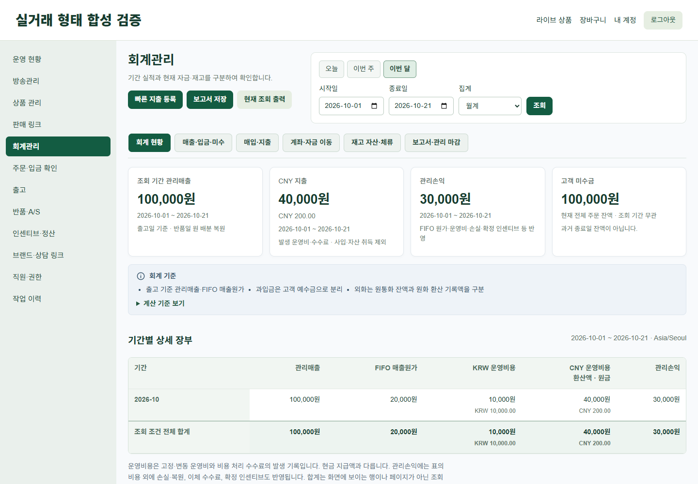
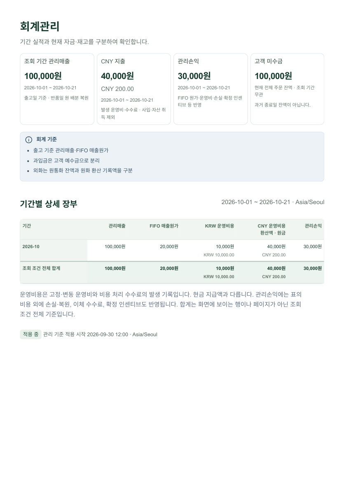

# 0.8.0 회계 현황 최종 디자인 보완

> 최신 캡처 피드백 보완: [방송 작업 버튼·지출 요약/업무 메뉴·모바일 KPI/장부](ADMIN_UI_080_POLISH.md). 아래는 그 이전 단계의 기록입니다.

2026-10-21. 기준 HEAD `d222ad35d0ef23e6f010dc0c34fb79a9207e390b` 유지. 앞선 미커밋 0.8.0의 공통 메뉴·방송 탭·회계 하위 화면 개선을 보존하고 이번 최종 기준을 추가 반영했다. 이 문서와 `verification/admin080-final/`이 최신 회계 현황 기준이다. 이전 `ADMIN_UI_080.md`의 6개 실적 카드/화면 순서와 캡처는 보완 전 기록이다.

## 반영한 화면

제목·기간 필터 → 회계 탭 → **흰색 KPI 4개** → 짧은 기준 안내 → **기본으로 보이는 기간 장부** → 접힌 상세 분석·관리 기준 설정 순서다. PC에서는 제목/작업 버튼과 필터를 같은 행에 놓고 공간이 부족하면 자연스럽게 줄바꿈한다. 모바일 입력은 38px 높이와 14px 글자를 유지한다. 배경 #F8FAFC, 흰 카드, Golfif 녹색, KPI 26~30px, 12~14px 카드 간격, 얕은 경계/그림자를 적용했다.

| KPI | 실제 의미와 근거 |
|---|---|
| 조회 기간 관리매출 | 기존 보고서 `totals.revenue`. 출고일 FIFO 배분의 관리매출, 반품일 원 배분 복원. 주문액/입금액으로 대체하지 않는다. |
| CNY 지출 | **발생일 기준 운영비·비용 처리 수수료**의 저장 CNY 원금/저장 KRW 환산액. 사입·자산 취득은 제외. 거래 국가를 추정하지 않는다. 원금 합계×최신 환율 계산 없음. 환율 누락 시 KRW는 미확정, 원금과 등록 환산액은 보조 표시. |
| 관리손익 | 기존 보고서 `totals.management_subtotal`. FIFO 원가·손실/복원·고정/변동 운영비·이체 수수료·확정 인센티브 반영. 기존 null/불완전 판정을 그대로 미확정으로 표시한다. |
| 고객 미수금 | `current_analysis.balances.customers.receivable_krw`. **조회 시점 전체 주문의 현재 잔액**이며 조회 기간 발생분이나 종료일 잔액이 아니다. 카드에 그 의미를 기본 표시한다. |

현금·예수금·미지급 및 인센티브는 별도 펼침 영역이다. 현재 고객 예수금, 현재 지출 미지급, 기간 확정 인센티브를 서로 합치지 않는다. 기간 확정 인센티브는 지급할 잔액과 다른 값이며, 현재 미지급 인센티브 합계가 기존 서비스에 없어 새 숫자를 추정하지 않았다. 기존 인센티브·정산 메뉴에서 지급 상태를 확인한다.

안내 박스는 정보 SVG와 짧은 3개 항목만 기본 표시하고 자세한 기준·집계 버전은 ‘계산 기준 보기’에 남겼다. 기존 Blade 화면에는 아이콘 폰트가 로드되지 않아 외부 CDN/프레임워크 추가 없이 작은 정보 SVG를 사용했다. 자금 이동 화면에는 **실제 은행 송금은 수행하지 않음**을 기본 표시한다.

## 통화별 장부의 조회 근거

기존 서비스는 통화별 기간 비용을 반환하지 않으므로 `LiveFinanceDashboardService`에 **화면용 SELECT 집계 1개**를 추가했다. 기존 보고서와 같은 snapshot 트랜잭션 안에서 실행한다. 업체·기간을 DB에서 제한하고 날짜/월요일 주차/월과 통화로 그룹화한다. 비용 범위는 기존 fixed/variable과 동일한 `treatment IN (operating, fee)`, `cost_group IN (fixed, variable)`이며 역분개 부호를 적용한다. 원금은 DECIMAL 연산으로 minor 단위 합계, 환산액은 저장 `amount_krw`의 합이다. 재환산이나 새 환율 적용은 없다.

기간 장부는 기간/관리매출/FIFO 매출원가/KRW 운영비용/CNY 운영비용 환산액·원금/관리손익으로 구성했다. CNY 원금과 환산액은 두 줄로 표시한다. 합계는 전체 조건 대상이다. 통화별 등록 비용 합계가 기존 fixed+variable과 일치하는지 대사하고, 불일치 시 미확정·대사 안내를 표시한다. 기간 손익은 기존 기간 필드에 기존 공식(매출−원가−손실−고정−변동−수수료−인센티브)을 적용하며 전체 보고서가 불완전하면 기간 손익도 미확정으로 표시한다.

### 검증 중 발견한 기존 SQL 오류

양의 unsigned `amount_krw`에 정수 -1을 곱하는 기존 역분개 쿼리가 MySQL 오류 1690을 일으켰다. **계산 규칙을 바꾸지 않고** 기존 Report Service 부호 CASE의 정수 `-1/1`만 정확한 DECIMAL `-1.0/1.0`으로 바꿨다. 지출 목록 전체 합계와 새 화면 집계에도 동일하게 적용했다. 부동소수점이 아닌 SQL 십진 연산이며 금액·환율·반올림·역분개 발생일 정책을 바꾸지 않는다. 해당 오류를 드러낸 합성 역분개 사례가 회귀 테스트에 포함되어 있다.

FIFO·원가·환율 변환·원장 쓰기·주문/취소/반품·마감/재개·권한·업체 격리 규칙은 유지했다. 저장 보고서의 스키마·기준 버전·기존 스냅샷/해시를 변경하거나 재저장하지 않았다. 새 통화별 표는 일반 조회의 화면용 분해이며 기존 저장 보고서는 원래 보존된 집계·상세로 재출력된다. 신규 migration·데이터 변환은 없다.

## 실제 데이터 연결 검증

G7 애플리케이션의 실제 Blade와 공식 빌드 CSS/JS, localhost MySQL의 격리 합성 데이터다. 화면에 예시 숫자/증감률/가짜 차트를 삽입하지 않았다. 입고→FIFO 적용→주문→수동 입금→출고→비용 발생→부분 지급→다른 날 역분개를 기존 업무 Service로 실행한 별도 업체를 사용했다.

| 확인 | 월간 10/01~10/21 | 임의 기간 10/05~10/16 |
|---|---:|---:|
| 관리매출 | 100,000원 | 0원 |
| FIFO 원가 | 20,000원 | 0원 |
| KRW 운영비용 | 10,000원 | 10,000원 |
| CNY 원금·저장 환산 비용 | 200.00 CNY / 40,000원 | 250.00 CNY / 50,000원 |
| 관리손익 | 30,000원 | -60,000원 |
| 현재 고객 미수금 | 100,000원 | 100,000원 |

CNY 100×190 + 100×210 = 저장 환산액 40,000원이며 200×최근 환율 210 = 42,000원으로 계산하지 않았다. 별도 CNY 50/10,000원 비용은 10/15 발생·10/18 역분개라 기간에 따라 차이가 난다. 부분 지급은 20 CNY/3,800원뿐이므로 기간 운영비 50,000원과 현금 외부 유출 3,800원은 다르다. 고객 예수금 5,000원은 미수금 100,000원과 합치지 않았다.

- 설정 전에는 4개 카드 모두 ‘미설정’. GET·모달 열기·닫기 후 FinanceState/Operation/Audit/Expense/FundEntry/Report 수 동일. 사유 입력 후 명시적 확인에서만 적용된다.
- 설정 후 빈 업체에서는 실제 발생액 0을 표시하되, 적용 시작 이전 구간이 섞인 기간의 손익은 기존 정책대로 미확정이다.
- 원가 미등록/기초층 대기가 있는 기존 대량 합성 업체에서는 원가·관리손익을 미확정으로 표시했다.
- 방송과 회계 6개 탭을 방문해도 같은 메뉴 항목·순서·명칭 유지. 제한 sales 직원은 원가 카드가 없고 회계 현황 직접 접근은 403.
- 새 보고서 저장·재조회/재출력 일치, 기존 저장 보고서 재조회/재출력 불변을 실제 브라우저에서 확인했다.
- PC 1440/1920·모바일 390에서 제목/필터, 카드 4열/2열, 탭 내부 스크롤, 본문 넘침, 일반 화면과 A4 출력 확인.

| 최종 검증 | 결과 |
|---|---|
| 전체 PHP 회귀 | 243 tests / 72,827 assertions, 8분07초, 144MiB |
| 마지막 UI·통화 집중 회귀 | 7 tests / 2,471 assertions, 27.405초, 78MiB. 환율 미확정 지출의 역분개도 미확정 잔액으로 남기지 않음. |
| JS | 5 files / 13 tests. 기존 autoBinding React 경고 외 실패 없음. |
| 공식 설치 스모크 | 2 tests / 29 assertions |
| PHP 문법 검사 | 229개 파일, 오류 없음 |
| 공식 빌드·업데이트·캐시·무결성 | 모두 성공, 작업 소스/번들/활성 자산 SHA 일치 |

성공 테스트 수·빌드/정적 검사는 [release.json](verification/admin080-final/release.json), [브라우저 결과](verification/admin080-final/browser.json), [합성 집계 근거](verification/admin080-final/fixture.json)에 기록했다. 전체 PHP 회귀와 UI/통화 집중 검증, JS, 설치 스모크, PHP lint를 실행했다.

## 실제 화면 캡처

아래는 최종 빌드 자산과 DB 데이터가 연결된 실제 브라우저 화면이다. `-full` 파일은 페이지 전체, 나머지는 같은 1000px 높이의 뷰포트 캡처다.

| 상태 | PC 1440 | PC 1920 | 모바일 390 |
|---|---|---|---|
| 이번 달·데이터 있음 | [캡처](verification/admin080-final/data-month-1440.png) | [캡처](verification/admin080-final/data-month-1920.png) | [전체 캡처](verification/admin080-final/data-month-390-full.png) |
| 임의 기간 | [전체](verification/admin080-final/data-custom-1440-full.png) | [전체](verification/admin080-final/data-custom-1920-full.png) | [전체](verification/admin080-final/data-custom-390-full.png) |
| 데이터 없음 | [전체](verification/admin080-final/data-empty-1440-full.png) | [전체](verification/admin080-final/data-empty-1920-full.png) | [전체](verification/admin080-final/data-empty-390-full.png) |
| 원가 미확정 | [전체](verification/admin080-final/cost-unknown-1440-full.png) | [전체](verification/admin080-final/cost-unknown-1920-full.png) | [전체](verification/admin080-final/cost-unknown-390-full.png) |
| 초기 설정 전 | [전체](verification/admin080-final/setup-before-1440-full.png) | [전체](verification/admin080-final/setup-before-1920-full.png) | [전체](verification/admin080-final/setup-before-390-full.png) |
| 적용 후 | [전체](verification/admin080-final/setup-after-1440-full.png) | [전체](verification/admin080-final/setup-after-1920-full.png) | [전체](verification/admin080-final/setup-after-390-full.png) |

[초기 설정 확인 창](verification/admin080-final/setup-dialog-390.png) · [제한 직원](verification/admin080-final/limited-sales.png). 방송·회계 하위 6개 화면의 3개 폭 캡처도 같은 디렉터리에 보존했다. 앞선 [보완 전 전후 비교](ADMIN_UI_080.md#실제-전후-캡처)는 그대로 남겼다.

## A4 출력

기본 출력은 **조건 전체 기간 장부**다. 좁은 화면의 스크롤 위치나 보이는 행만 출력하지 않는다. 접힌 추가 상세 분석은 자동으로 펼치지 않으며, 사용자가 펼친 경우 함께 출력된다. 기존 불변 저장 보고서의 분할 출력은 유지한다.

[월간 A4 PDF — 1쪽](verification/admin080-final/pdf/data-month.pdf) · [임의 기간 A4 PDF — 2쪽](verification/admin080-final/pdf/data-custom.pdf) · [PDF 검사 결과](verification/admin080-final/pdf-checks.json).

전체 PDF 페이지를 렌더링·시각 검토했고 관리자 메뉴/탭/작업 버튼이 없으며, 임의 기간 마지막 날짜와 전체 합계가 출력되는 것을 확인했다. 실제 종이 프린터는 실행하지 않았다.

## 환경·배포 대상

실제 **Windows / PHP 8.4.26 / MySQL 8.4.11 / Chrome 155.0.8059.84**. DB는 localhost:33319의 `live_accounting060_isolated_test`, `live_accounting060_isolated_browser`만 사용했다. 목표 운영 **PHP 8.3.6 / MySQL 8.0.46**에서 직접 실행하지 않았다. 실제 휴대전화·Safari·Firefox도 미검증이다. 운영 DB/자격정보를 사용하지 않았다.

최종 대상은 `plugins/_bundled/yutiv-live_commerce/` 전체 **0.8.0**이며 앞선 미커밋 버전의 최종 보완이다. 소스와 공식 dist/등록 manifest를 함께 유지했다. 공식 `plugin:build` → `plugin:update --force` → view 캐시 갱신/`route:cache` → `vendor:verify`를 격리 환경에서 검증했다. 실제 적용 시의 배포·OPcache/프록시 캐시 절차는 [기존 배포 안내](ADMIN_UI_080.md#배포-대상과-캐시-갱신-절차)를 따른다. 공개 API/스키마 변경이 없고 이 플러그인 의존 번들 확장이 없어 타 확장 최소 버전 변경 대상도 없다.

**commit·push·운영 접속·운영 배포 없음.**
