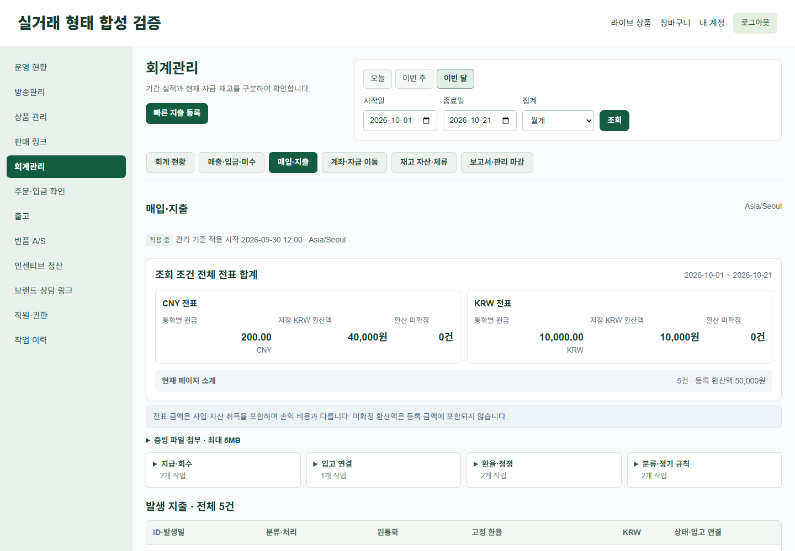
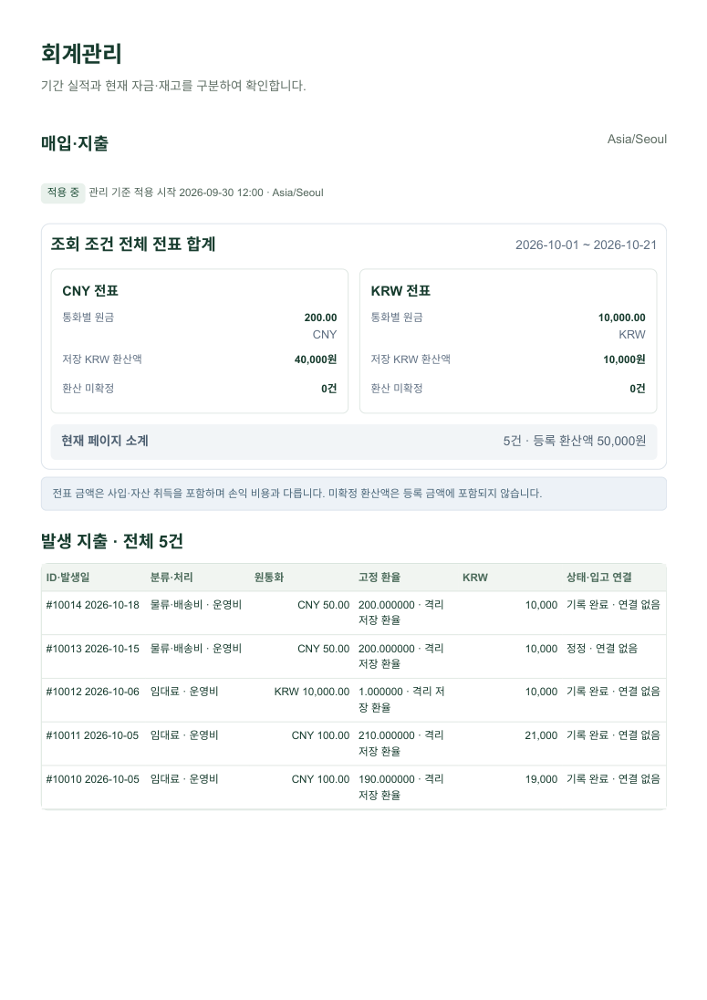

# 0.8.0 최종 캡처 피드백 보완

2026-10-21. 기존 미커밋 0.8.0 작업과 HEAD `d222ad35d0ef23e6f010dc0c34fb79a9207e390b`를 보존했다. 이번 변경은 아래 표시 영역과 공식 dist·검증·문서에 한정한다. 이번 지시 시작 시의 `src/`·`database/` **128개 파일 SHA-256이 모두 동일**하다. 회계 계산·원장·스냅샷·Controller·권한·DB 구조를 변경하지 않았으며 migration도 없다. [보존 근거](verification/admin080-polish/backend-preserved.json).

## 반영 결과

- 방송 목록의 관리/고객 화면 열기를 36px 보조 버튼으로 분리하고 8px 간격을 적용했다. 초기화도 같은 스타일이다. href·검색 조건·새 창·noopener를 유지하고 실제 이동을 검증했다. 방문/hover/키보드 focus에서도 기본 파란색·보라색·밑줄이 남지 않도록 명시했다.
- 매입·지출의 **전체 조회 전표 합계**를 흰 카드로 묶고 통화별 원금/저장 KRW/미확정 건수를 정렬했다. 현재 페이지 등록분 소계는 회색 보조 줄로 분리하고, 전표와 손익 비용의 차이는 짧은 안내에 남겼다. 원금의 소수 2자리 이후 불필요한 0만 정리하며 반올림·환산은 하지 않는다.
- 빠른 지출 등록은 주요 버튼으로 유지했다. 기존 7개 작업은 아래 네 접이식 메뉴로 구분했다. 권한 필터와 모든 기존 form/action/필드를 유지한다. 메뉴 열기/대화상자 열기/닫기는 DOM 동작뿐이며 저장 요청을 보내지 않는다.

| 보조 메뉴 | 기존 기능 |
|---|---|
| 지급·회수 | 분할 지급·입고 매입대금 지급 / 지급금 회수 |
| 입고 연결 | 기등록 매입 지출·입고 연결 |
| 환율·정정 | 대기 지출 환율 확정 / 미지급 지출 역분개 |
| 분류·정기 규칙 | 지출 분류·하위 분류 등록 / 정기 지출 규칙 |

기존 지출 역분개를 실제 현금 환불로 바꾸거나 새 환불 기능을 만들지 않았다. 실제 지급금 회수는 기존 지급·회수 작업으로 연결한다.

- KPI 조회 기간은 카드 묶음 위 한 곳에 표시한다. 금액 크기는 유지하고 카드 설명을 짧은 기준+펼치는 도움말로 나눴다. 고객 미수금의 **현재 전체 주문 잔액·조회 기간 무관**, CNY 원금, 미확정 상태는 기본 표시로 유지한다. 원가가 미확정이면 관리손익 카드에 ‘원가 미확정’도 직접 표시한다. 큰 금액은 모바일 카드가 한 행을 사용하여 숫자를 작게 만들지 않는다.
- 모바일 장부는 숨긴 열이 아닌 내부 가로 스크롤임을 확인했다. ‘좌우로 밀어 원가·비용·손익 확인’과 양쪽 경계 그라데이션/선을 추가했다. 스크롤 끝에 닿으면 해당 방향 표시는 사라진다. 영역은 키보드로 포커스할 수 있으며 페이지 전체 가로 넘침을 만들지 않는다.
- A4에서는 스크롤 안내·경계 표시·작업 메뉴를 숨기고 장부의 모든 열을 출력한다. 큰 금액의 카드만 2열로 배치하며 지출 표는 용지 안에서 줄바꿈한다. 인쇄 선택자 우선순위를 확인했으며 `!important`는 추가하지 않았다.

## 영향 검증

| 검증 | 실제 결과 |
|---|---|
| 관련 PHP UI·권한 회귀 | **2 tests / 739 assertions**, 00:30.038 (분:초), 76MiB |
| 관련 JS | finance/broadcasts **2 files / 3 tests** 통과 |
| 영향 PHP 문법 | Blade 5개·격리 fixture 2개, **7개 통과** |
| 데이터 변경 없음 | 7개 대화상자와 네 메뉴 열기/닫기 전후 11개 업무 테이블 수 동일, 회계 POST **0건** |
| 모바일 실제 터치 | Chrome CDP touchStart/touchMove/touchEnd, **isTrusted=true 4회**, scrollLeft **0→584px**, 6개 열 모두 실제 노출 확인 |
| 장부 전체 합계 | 오른쪽 끝의 CNY 40,000원/200.00 CNY와 관리손익 **30,000원** 확인 |
| 페이지네이션 | 전체 합계 **10,412,345원**은 1·2페이지 동일. 현재 페이지 소계는 각각 **129,345원 / 20,000원**으로 구분 |
| 큰 금액 | 별도 격리 업체의 실제 Service 생성 데이터: CNY 환산 **123,333,372,331원**, 관리손익 **-122,333,402,331원**, 미수 **1,000,000,000원**. 390px 잘림/페이지 가로 넘침 없음 |
| 미확정 표시 | 원가 미등록 업체의 미확정 손익이 기본 카드에 유지됨 |
| 제한 직원 | sales 직원의 매입·지출 직접 접근 **403**, 기존 서버 권한 유지 |
| 브라우저 | 실제 G7 Blade·공식 빌드 자산, Chrome **155.0.8059.84**, PC **1440/1920×1000**, 모바일 **390×1000** + 터치 에뮬레이션 |
| 인쇄 | 일반 현황·큰 금액 현황·매입/지출 **A4 각 1쪽**. 모든 페이지 렌더링·시각 검토. 제목·전체 열·합계·용지 경계 안 텍스트 확인, 관리자/스크롤 안내/업무 버튼 제외 |

표시 영역 변경이므로 금융 전체 테스트를 반복하지 않았다. 기존 금융 계산 서비스·DB 구조의 바이트 보존 확인과 영향받는 UI/권한/JS/브라우저/인쇄 검증을 수행했다. 데이터는 localhost:33319의 격리 DB뿐이며 기존 업무 데이터와 별도 큰 금액 합성 업체를 사용했다. DOM에 예시 금액을 넣은 화면이 아니다.

[브라우저 결과](verification/admin080-polish/browser.json) · [페이지별 합계](verification/admin080-polish/pagination.json) · [큰 금액 집계 근거](verification/admin080-polish/large.json) · [PDF 검사](verification/admin080-polish/pdf-checks.json) · [빌드/릴리스](verification/admin080-polish/release.json).

## 수정 후 실제 캡처

| 대상 | PC 1440 | PC 1920 | 모바일 390 |
|---|---|---|---|
| 방송 작업 버튼 | [캡처](verification/admin080-polish/broadcasts-1440.png) | [캡처](verification/admin080-polish/broadcasts-1920.png) | [전체](verification/admin080-polish/broadcasts-390-full.png) |
| 지출 요약·보조 메뉴 | [캡처](verification/admin080-polish/expenses-1440.png) | [캡처](verification/admin080-polish/expenses-1920.png) | [전체](verification/admin080-polish/expenses-390-full.png) |
| KPI·장부 | [전체](verification/admin080-polish/overview-1440-full.png) | [전체](verification/admin080-polish/overview-1920-full.png) | [전체](verification/admin080-polish/overview-390-full.png) |

[모바일 업무 메뉴 펼침](verification/admin080-polish/expenses-menus-open-390.png) · [큰 금액 KPI](verification/admin080-polish/large-kpi-390-full.png) · [미확정 KPI](verification/admin080-polish/unknown-kpi-390-full.png) · [장부 시작](verification/admin080-polish/ledger-scroll-start-390.png) · [터치로 이동한 오른쪽 끝](verification/admin080-polish/ledger-scroll-end-390.png) · [실제 2페이지 소계](verification/admin080-polish/expenses-page2-1440.png).

[A4 일반 현황](verification/admin080-polish/pdf/overview.pdf) · [A4 큰 금액](verification/admin080-polish/pdf/large-overview.pdf) · [A4 매입·지출](verification/admin080-polish/pdf/expenses.pdf).

## 파일·배포 자료

표시 소스: `resources/views/seller/broadcasts.blade.php`, `finance.blade.php`, `finance-dashboard.blade.php`, 새 `finance-expense-summary.blade.php`, `finance-work-actions.blade.php`, `resources/css/admin.css`, `resources/js/finance.js`. 공식 dist·등록 manifest, 격리 UI 검증 스크립트와 문서를 갱신했다. 기존 미커밋 파일을 되돌리거나 삭제하지 않았다.

기존 미커밋 릴리스의 최종 보완이므로 **0.8.0**을 유지한다. 대상은 플러그인 전체이며 소스와 dist를 함께 반영한다. 공식 `plugin:build`/`plugin:update --force`, view/route 캐시·vendor 무결성 검증은 격리 복사본에서 수행했다. 기존 [배포·캐시 갱신 절차](ADMIN_UI_080.md#배포-대상과-캐시-갱신-절차)를 따른다. 이번에는 **commit·push·운영 접속·배포 없음**.

실제 검증 **PHP 8.4.26 / MySQL 8.4.11**과 운영 대상 **PHP 8.3.6 / MySQL 8.0.46**의 차이는 남아 있다. 목표 버전 직접 실행·실물 휴대전화·종이 프린터는 미검증이며 Chrome 터치 이벤트/A4 PDF로 확인했다.
